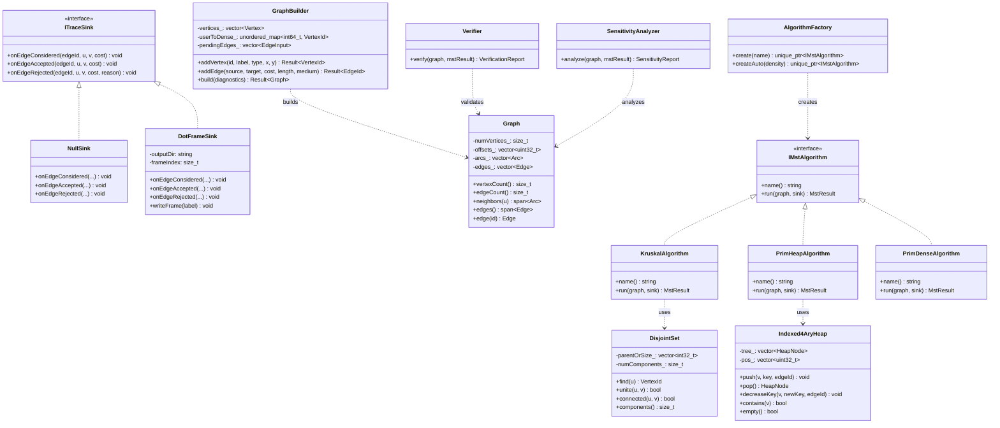

# Architecture Specification: Network Cable Optimization System (netopt)

## 1. Overview & High-Level Design

The **Network Cable Optimization System (`netopt`)** is a pure C++20 application designed to model telecommunications and computer networks as undirected, weighted graphs and optimize cable routing costs using Minimum Spanning Tree (MST) / Minimum Spanning Forest (MSF) algorithms.

The architecture emphasizes:
- **Immutability and Value Semantics**: Once validated and built by `GraphBuilder`, `Graph` is completely immutable and memory-compact.
- **Cache-Conscious Data Structures**: Compressed Sparse Row (CSR) adjacency representations and an indexed 4-ary heap.
- **Deterministic Total Ordering**: Strict tie-breaking using composite keys `(cost, edge_id)` ensuring Prim and Kruskal yield identical edge sets on any graph.
- **Clean Separation of Concerns**: Decoupled parsing (`io/`), algorithm execution (`algo/`), validation and sensitivity analysis (`analysis/`), output formatting (`export/`), and interaction (`ui/`).

---

## 2. Design Patterns

| Pattern | Component | Purpose & Description |
|---|---|---|
| **Builder** | `GraphBuilder` -> `Graph` | Validates vertices and edges incrementally, deduplicates parallel edges (keeping lowest cost), eliminates self-loops, and compiles into an immutable, contiguous CSR `Graph`. |
| **Strategy** | `IMstAlgorithm` | Abstract interface `name()` and `run(const Graph&, ITraceSink&)` implemented by `KruskalAlgorithm`, `PrimHeapAlgorithm`, and `PrimDenseAlgorithm`. |
| **Factory** | `AlgorithmFactory::create(name)` | Instantiates algorithm strategies by name/identifier, preventing UI/caller coupling to concrete classes. |
| **Observer** | `ITraceSink` | Event-driven tracing with callbacks (`onEdgeConsidered`, `onEdgeAccepted`, `onEdgeRejected`). Receivers include `NullSink`, `ConsoleTraceSink`, `DotFrameSink`, and `BenchmarkTraceSink`. |
| **Repository** | `IGraphRepository` / `CsvGraphRepository` | Abstraction over persistent storage for network topology and MST solutions with atomic file write semantics (`<file>.tmp` -> rename). |

---

## 3. Class & Component Diagram (Mermaid)

---

## 4. Data Structure Justifications

### 4.1. Compressed Sparse Row (CSR) Representation
Traditional graph representations use `std::vector<std::vector<Edge>>` (adjacency list of vectors). While intuitive, this introduces:
1. One heap allocation per vertex.
2. Pointer indirection and cache line misses during traversal.
3. Unfavorable memory fragmentation for large topologies.

`netopt` represents graph connectivity with **Compressed Sparse Row (CSR)**:
- `offsets_`: Contiguous `std::vector<uint32_t>` of size $V + 1$, where `offsets_[u]` marks the starting index in `arcs_` for vertex `u`.
- `arcs_`: Contiguous `std::vector<Arc>` of size $2E$, where each `Arc` contains `target`, `cost`, and `edge_id`.
- Traversal of vertex $u$'s neighborhood is a direct slice `std::span(&arcs_[offsets_[u]], &arcs_[offsets_[u+1]])`. All arcs reside in contiguous physical memory, maximizing L1/L2 cache prefetching during graph traversal.

### 4.2. Indexed 4-Ary Heap
Prim's algorithm on sparse graphs requires frequent priority updates (`decreaseKey`).
- Standard `std::priority_queue` does not support `decreaseKey`, forcing eager insertions and lazy deletions that bloat heap size to $O(E)$ and incur redundant pop operations.
- A binary heap has height $\lceil \log_2 V \rceil$.
- A **4-ary heap** reduces tree height by a factor of 2 ($\lceil \log_4 V \rceil$). Each internal node has 4 children, aligning well with modern 64-byte cache lines (storing 4 child keys together in memory).
- `pos_` array maps each `VertexId` to its current position in the heap array, enabling $O(\log_4 V)$ `decreaseKey` with in-place sift-up.

### 4.3. Disjoint Set Union (DSU)
Kruskal's algorithm depends on dynamic connectivity checks.
- Union-by-size combined with iterative two-pass or single-pass path halving yields an amortized time complexity of $O(\alpha(V))$ per operation, where $\alpha$ is the inverse Ackermann function ($\alpha(V) \le 4$ for all physical network scales).
- Uses a compact single array `vector<int32_t> parentOrSize_` where root nodes store negative subtree size (`-size`) and non-roots store parent indices.

### 4.4. Error Handling: `Result<T, E>`
In compliance with pure C++20 constraints and strict warning-free flags:
- A custom, zero-overhead `Result<T, Error>` template modeled after monadic error handling avoids C++23 dependencies (`std::expected`) and avoids exception overhead in high-throughput validation routines.
