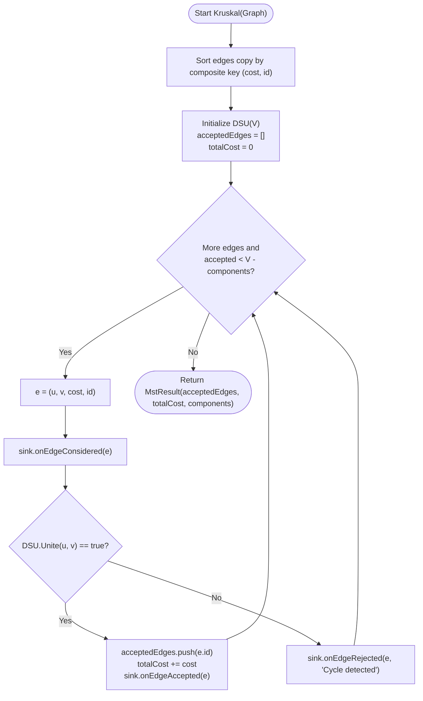
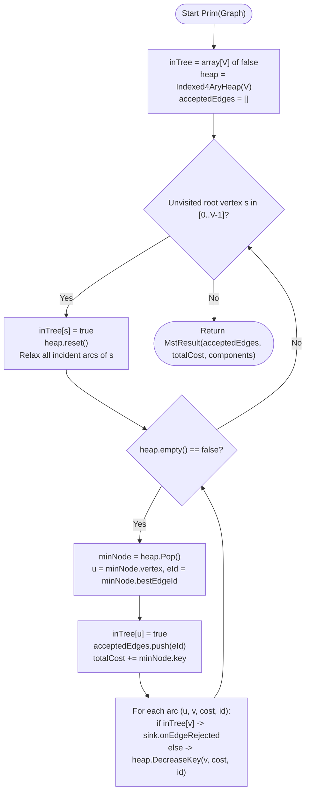

# Algorithm Pseudocode & Flowcharts (docs/PSEUDOCODE.md)

This document provides formal pseudocode, data structure mechanics, and Mermaid execution flowcharts for the core graph algorithms in the **Network Cable Optimization System (`netopt`)**.

---

## 1. Disjoint Set Union (DSU)

### 1.1. Pseudocode
```text
Algorithm DisjointSet(N):
    parentOrSize <- array of size N initialized to -1   // -size for roots
    components <- N

Function Find(x):
    root <- x
    while parentOrSize[root] >= 0:
        // Iterative Path Halving: point root to grandparent
        parent <- parentOrSize[root]
        if parentOrSize[parent] >= 0:
            parentOrSize[root] <- parentOrSize[parent]
            root <- parentOrSize[parent]
        else:
            root <- parent
            break
    return root

Function Unite(u, v):
    rootU <- Find(u)
    rootV <- Find(v)
    if rootU == rootV:
        return false  // already connected, cycle avoided

    // Union by size: attach smaller tree under larger tree
    if parentOrSize[rootU] > parentOrSize[rootV]:   // rootU has smaller size (less negative)
        swap(rootU, rootV)

    parentOrSize[rootU] <- parentOrSize[rootU] + parentOrSize[rootV]
    parentOrSize[rootV] <- rootU
    components <- components - 1
    return true
```

---

## 2. Indexed 4-Ary Min-Heap

### 2.1. Pseudocode
```text
Structure HeapNode:
    vertex: VertexId
    key: Cost
    bestEdgeId: EdgeId

Algorithm Indexed4AryHeap(maxV):
    heap <- dynamic array of HeapNode
    pos <- array of size maxV initialized to NOT_FOUND

Function Push(v, key, edgeId):
    idx <- size(heap)
    heap.append(HeapNode(v, key, edgeId))
    pos[v] <- idx
    SiftUp(idx)

Function DecreaseKey(v, newKey, edgeId):
    idx <- pos[v]
    if (newKey, edgeId) < (heap[idx].key, heap[idx].bestEdgeId):
        heap[idx].key <- newKey
        heap[idx].bestEdgeId <- edgeId
        SiftUp(idx)
        return true
    return false

Function Pop():
    minNode <- heap[0]
    pos[minNode.vertex] <- NOT_FOUND
    lastNode <- heap.pop_back()
    if not heap.empty():
        heap[0] <- lastNode
        pos[lastNode.vertex] <- 0
        SiftDown(0)
    return minNode

Function SiftUp(i):
    while i > 0:
        parent <- (i - 1) / 4
        if heap[i] < heap[parent]:
            SwapNodes(i, parent)
            i <- parent
        else:
            break

Function SiftDown(i):
    while true:
        firstChild <- 4 * i + 1
        if firstChild >= size(heap):
            break
        bestChild <- firstChild
        lastChild <- min(firstChild + 4, size(heap))
        for c from firstChild + 1 to lastChild - 1:
            if heap[c] < heap[bestChild]:
                bestChild <- c
        if heap[bestChild] < heap[i]:
            SwapNodes(i, bestChild)
            i <- bestChild
        else:
            break
```

---

## 3. Kruskal's Algorithm

### 3.1. Flowchart (Mermaid)


### 3.2. Pseudocode
```text
Algorithm Kruskal(G, sink):
    sortedEdges <- copy of G.edges()
    sort(sortedEdges, by (cost, id))

    dsu <- DisjointSet(G.vertexCount())
    acceptedEdges <- empty list
    totalCost <- 0
    targetComponents <- countConnectedComponents(G)

    for edge in sortedEdges:
        sink.onEdgeConsidered(edge)
        if dsu.Unite(edge.u, edge.v):
            acceptedEdges.append(edge.id)
            totalCost <- totalCost + edge.cost
            sink.onEdgeAccepted(edge)
            if dsu.components == targetComponents:
                break // early termination once all components spanned
        else:
            sink.onEdgeRejected(edge, "Cycle detected")

    sort(acceptedEdges)
    return MstResult(acceptedEdges, totalCost, dsu.components)
```

---

## 4. Prim's Algorithm (Indexed 4-Ary Heap)

### 4.1. Flowchart (Mermaid)


### 4.2. Pseudocode
```text
Algorithm PrimHeap(G, sink):
    V <- G.vertexCount()
    inTree <- array of size V initialized to false
    heap <- Indexed4AryHeap(V)
    acceptedEdges <- empty list
    totalCost <- 0
    components <- 0

    for s from 0 to V - 1:
        if inTree[s]:
            continue
        components <- components + 1
        inTree[s] <- true
        heap.reset()

        for arc in G.neighbors(s):
            sink.onEdgeConsidered(arc)
            heap.DecreaseKey(arc.target, arc.cost, arc.id)

        while not heap.empty():
            node <- heap.Pop()
            u <- node.vertex
            inTree[u] <- true
            acceptedEdges.append(node.bestEdgeId)
            totalCost <- totalCost + node.key
            sink.onEdgeAccepted(node.bestEdgeId)

            for arc in G.neighbors(u):
                if inTree[arc.target]:
                    sink.onEdgeRejected(arc, "Endpoints already connected")
                else:
                    sink.onEdgeConsidered(arc)
                    heap.DecreaseKey(arc.target, arc.cost, arc.id)

    sort(acceptedEdges)
    return MstResult(acceptedEdges, totalCost, components)
```

---

## 5. Prim's Dense Algorithm ($O(V^2)$ Array Scan)

### 5.1. Pseudocode
```text
Algorithm PrimDense(G, sink):
    V <- G.vertexCount()
    minDist <- array of size V initialized to INFINITY
    bestEdge <- array of size V initialized to NONE
    inTree <- array of size V initialized to false
    acceptedEdges <- empty list
    totalCost <- 0
    components <- 0

    for s from 0 to V - 1:
        if inTree[s]:
            continue
        components <- components + 1
        inTree[s] <- true

        for arc in G.neighbors(s):
            sink.onEdgeConsidered(arc)
            if (arc.cost, arc.id) < (minDist[arc.target], bestEdge[arc.target]):
                minDist[arc.target] <- arc.cost
                bestEdge[arc.target] <- arc.id

        while true:
            bestV <- NONE
            bestKey <- INFINITY
            bestE <- NONE

            // O(V) linear scan over unvisited vertices
            for v from 0 to V - 1:
                if not inTree[v] and minDist[v] < INFINITY:
                    if (minDist[v], bestEdge[v]) < (bestKey, bestE):
                        bestKey <- minDist[v]
                        bestE <- bestEdge[v]
                        bestV <- v

            if bestV == NONE:
                break // component fully spanned

            inTree[bestV] <- true
            acceptedEdges.append(bestE)
            totalCost <- totalCost + bestKey
            sink.onEdgeAccepted(bestE)

            for arc in G.neighbors(bestV):
                if inTree[arc.target]:
                    sink.onEdgeRejected(arc, "Endpoints already connected")
                else:
                    sink.onEdgeConsidered(arc)
                    if (arc.cost, arc.id) < (minDist[arc.target], bestEdge[arc.target]):
                        minDist[arc.target] <- arc.cost
                        bestEdge[arc.target] <- arc.id

    sort(acceptedEdges)
    return MstResult(acceptedEdges, totalCost, components)
```

---

## 6. Sensitivity Analysis & Binary Lifting Path-Max

### 6.1. Pseudocode
```text
Algorithm BinaryLiftingPreprocess(Tree, V):
    logN <- ceil(log2(V)) + 2
    up[k][v] <- 2^k ancestor of v
    maxEdge[k][v] <- maximum edge on 2^k path from v

    Run DFS from each tree root to compute depth[v] and up[0][v]
    for k from 1 to logN - 1:
        for v from 0 to V - 1:
            p <- up[k - 1][v]
            if p != -1:
                up[k][v] <- up[k - 1][p]
                maxEdge[k][v] <- max(maxEdge[k - 1][v], maxEdge[k - 1][p])

Function QueryPathMax(u, v):
    Lift deeper vertex to depth of shallower vertex, accumulating maxEdge
    if u == v: return maxEdge
    Lift both simultaneously until up[k][u] == up[k][v]
    return max(maxEdge, edgeToLCA_u, edgeToLCA_v)

Algorithm SensitivityAnalysis(G, MST):
    Lifting <- BinaryLiftingPreprocess(MST, G.vertexCount())
    
    // 1. Non-Tree Edge Tolerances
    for each non-tree edge e = (u, v):
        maxTreeEdge <- Lifting.QueryPathMax(u, v)
        tolerance[e] <- e.cost - maxTreeEdge.cost

    // 2. Tree Edge Replacements and Bridges via Tree Jump Contraction
    treeEdges <- MST.edges
    Mark all treeEdges as bridges (replacement = NONE)
    Sort nonTreeEdges by cost ascending
    
    for each nonTreeEdge e = (u, v):
        lca <- LCA(u, v)
        Traverse unvisited tree edges on path u -> lca and v -> lca:
            Assign replacement[treeEdge] <- e
            Mark treeEdge as covered (not a bridge)
            Jump path to lca using path compression

    return Report(treeEdges, nonTreeEdges, secondBestMst)
```

---

## 7. Self-Verification Engine

### 7.1. Pseudocode
```text
Algorithm VerifyMst(G, MST):
    V <- G.vertexCount()
    c <- countComponents(G)
    
    // Property 1: Correct edge count
    if MST.edges.size() != V - c:
        return Failure("Edge count mismatch: expected V - c")

    // Property 2 & 3: Acyclicity & Spanning
    dsu <- DisjointSet(V)
    for edge in MST.edges:
        if not dsu.Unite(edge.u, edge.v):
            return Failure("Cycle detected in MST")
    if dsu.components != c:
        return Failure("MST does not span all components")

    // Property 4: Cycle Optimality Property
    for each non-tree edge e = (u, v) in G:
        maxTreeEdge <- FindMaxEdgeOnPath(u, v, in MST)
        if (e.cost, e.id) < (maxTreeEdge.cost, maxTreeEdge.id):
            return Failure("Cycle property violated: non-tree edge cheaper than tree path edge")

    return Success("Verified optimal")
```
